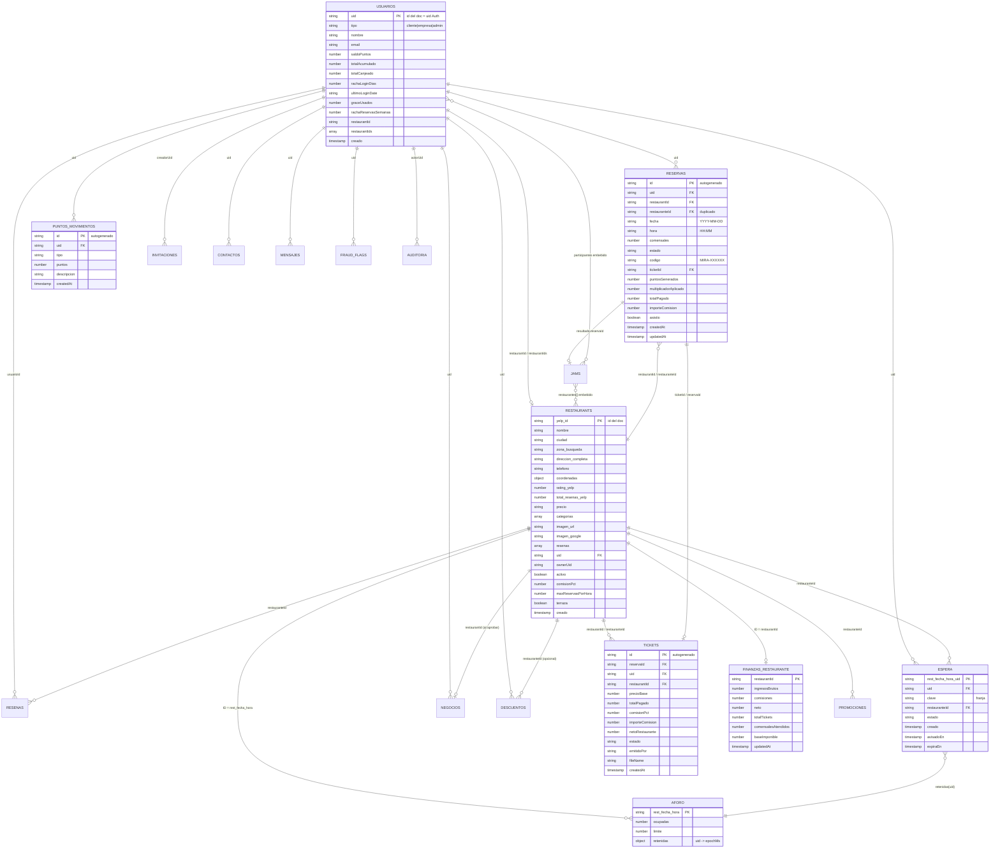
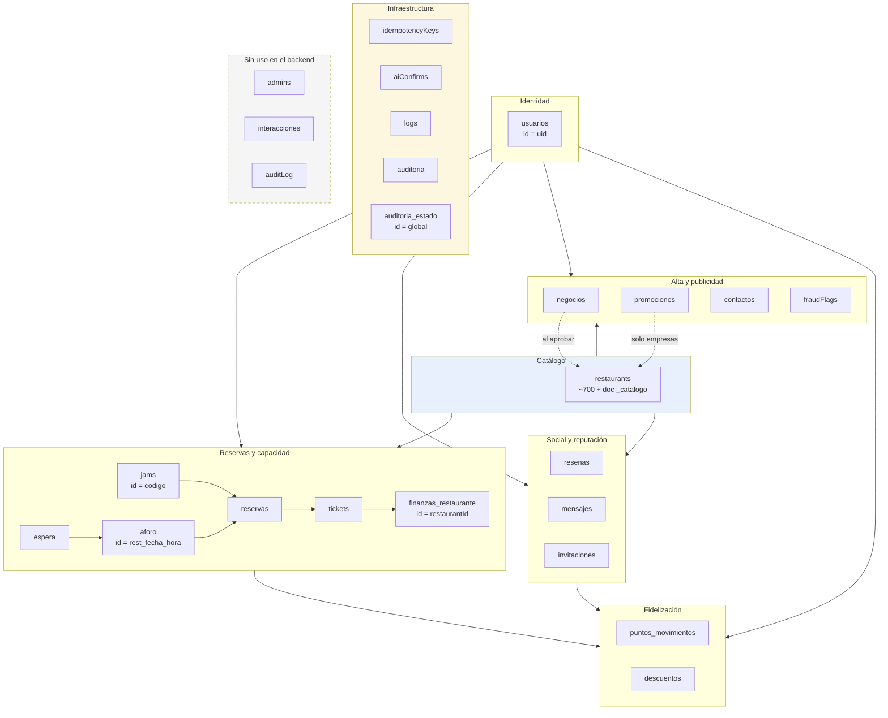

# Base de datos — MIRA POINTS

Documento técnico de referencia del modelo de datos. Todo el esquema descrito aquí se ha
extraído leyendo el código real (`src/modules/*/service.js`, `src/middlewares/*.js`,
`firestore.rules`, `firestore.indexes.json`), no de un diseño teórico.

---

## 1. Tipo de base de datos

| Propiedad | Valor |
|---|---|
| Motor | **Cloud Firestore** (NoSQL documental) |
| Proyecto | `restaurante-mira-18e0c` (`src/config/env.js:18`, `.firebaserc`) |
| Driver | `firebase-admin` v12 (`admin.firestore()` en `src/middlewares/verifyFirebaseAuth.js:25`) |
| Modelo | Colecciones de nivel raíz + documentos con clave propia. **Sin subcolecciones**: todas las relaciones son por IDreferences en campos, no por rutas anidadas |
| Acceso | API Express (Node ≥20) con firebase-admin, que **ignora `firestore.rules`**. Las reglas solo aplican al cliente (web/SDK) |
| Emulador | Configurado en `firebase.json` (`FIRESTORE_EMULATOR_HOST`, puerto 8080) |
| Plan | Spark (gratuito) según los comentarios del código: topes de 50.000 lecturas/día, 20.000 escrituras/día y 1 GiB. Varias decisiones de diseño (cachés, bloques de log, topes diarios) existen precisamente para no agotar esas cuotas |

**Convención de nombres**: mezcla deliberada. Las colecciones del dominio del usuario usan
español (`reservas`, `usuarios`, `mensajes`, `puntos_movimientos`, `finanzas_restaurante`); las
de infraestructura usan camelCase inglés (`idempotencyKeys`, `fraudFlags`, `aiConfirms`).
`reservas` y `mensajes` conviven en la raíz con nombres en español; `restaurants` conserva el nombre inglés
porque la carga viene de Yelp vía `yelp-connection/index.js`.

---

## 2. Esquema

Convenciones de tipo:

- `Timestamp` = `new Date()` (Firestore lo guarda como timestamp del servidor).
- `String` = cadena corta (< 500 B) salvo indicación.
- `null` explícito es habitual: el código serializa a `null` en lugar de omitir, salvo en
  `auditoria`, donde `limpiarUndefined()` las elimina.
- `Date|string` = hay lecturas que toleran ambos formatos (el emulador de tests y los mocks
  devuelven `Date` o texto ISO; `espera/service.js:20` centraliza esa conversión en `aMs()`).

### 2.1 `usuarios` — perfiles y saldos

ID de documento = **uid de Firebase Auth**. Raíz de identidad y roles.

| Campo | Tipo | Escrito por |
|---|---|---|
| `tipo` | `String` (`cliente`\|`empresa`\|`admin`) | `users/service.js:43` (perfil), `negocios/service.js:79` (aprobación → `empresa`) |
| `nombre` | `String` | `users/service.js:43` |
| `email` | `String` | `users/service.js:43` |
| `soloVegano` | `Boolean` | `users/service.js:43` |
| `alergias` | `Array<String>` | `users/service.js:43` |
| `lang` | `String` | `users/service.js:43` |
| `consentimientoCookies` | `Object\|null` | `users/service.js:43` |
| `preferencias` | `Object\|null` | `users/service.js:43` |
| `accesibilidad` | `Object\|null` | `users/service.js:43` |
| `favoritos` | `Array<String>` (ids de restaurante) | `users/service.js:43` |
| `restaurantId` | `String\|null` (id de `restaurants`) | `negocios/service.js:80` |
| `restaurantIds` | `Array<String>` | `negocios/service.js:79` |
| `saldoPuntos` | `number` | `points/service.js:99,127,178,266`, `points/dailyLogin.js:36`, `reservations/service.js:162`, `invitations/service.js:88` |
| `totalAcumulado` | `number` | `points/service.js:101`, `dailyLogin.js:37`, `reservations/service.js:163`, `invitations/service.js:90` |
| `totalCanjeado` | `number` | `points/service.js:102,128,268` |
| `rachaLoginDias` | `number` (0–7) | `points/dailyLogin.js:19,37`, `points/service.js:181`, `dashboard/service.js:751,773,794`, `cron/streaks.js:38,44` |
| `ultimoLoginDate` | `String` `YYYY-MM-DD` (día local Europe/Madrid) | `points/dailyLogin.js:20`, `points/service.js:182`, `dashboard/service.js:752,774,795` |
| `graceUsados` | `number` (0–2) | `points/dailyLogin.js:21`, `points/service.js:183`, `dashboard/service.js:753,776,796` |
| `rachaReservasSemanas` | `number` | `cron/streaks.js:38,44` |
| `rachaReservasMultiplicador` | `number` | `cron/streaks.js:39,45` |
| `rachaReservasUltimaSemana` | `String` `AAAA-Www` (ISO 8601) | `cron/streaks.js:40,46` |
| `updatedAt` | `Timestamp` | `points/service.js:103,129,184`, `dailyLogin.js:40`, `dashboard/service.js:754` |
| `actualizado` | `Timestamp` | `users/service.js:42` |
| `createdAt` | `Timestamp` | **No lo escribe el backend.** Solo se lee (`users/service.js:25,73`). Lo crea el frontend al registrarse. No determinable con certeza su formato desde este código |

> Nota de riesgo: `createdAt` y `actualizado` coexisten como dos campos de fecha de alta
> distintos. `users/service.js:43` escribe `actualizado`; el resto de módulos escriben `updatedAt`.

### 2.2 `restaurants` — catálogo

ID de documento = **`yelp_id`** de Yelp para los importados (`yelp-connection/index.js:443`) o
**autogenerado** para los aprobados desde `negocios` (`negocios/service.js:66`).

#### Documento de restaurante

| Campo | Tipo | Escrito por |
|---|---|---|
| `nombre` | `String` | `yelp-connection/index.js:184` (seed), `negocios/service.js:85` (aprobación), `restaurants/service.js:436` |
| `yelp_id` | `String` | `yelp-connection/index.js:183` (solo seed) |
| `zona_busqueda` | `String` | `yelp-connection/index.js:185`, `negocios/service.js:88` |
| `direccion` | `String` | `yelp-connection/index.js:186`, `restaurants/service.js:437` |
| `direccion_completa` | `String` | `yelp-connection/index.js:190`, `negocios/service.js:89` |
| `ciudad` | `String` | `yelp-connection/index.js:187`, `negocios/service.js:87` |
| `codigo_postal` | `String` | `yelp-connection/index.js:188` (solo seed) |
| `pais` | `String` | `yelp-connection/index.js:189` (solo seed) |
| `telefono` | `String` | `yelp-connection/index.js:191`, `negocios/service.js:90`, `restaurants/service.js:438` |
| `coordenadas` | `Object{latitud, longitud}` | `yelp-connection/index.js:192` |
| `rating_yelp` | `number\|null` | `yelp-connection/index.js:196`, `negocios/service.js:93` (null al aprobar) |
| `total_resenas_yelp` | `number` | `yelp-connection/index.js:197`, `negocios/service.js:94` |
| `precio` | `String` (`€`\|`€€`\|`€€€`) | `yelp-connection/index.js:198`, `negocios/service.js:86`, `restaurants/service.js:444` |
| `categorias` | `Array<String>` | `yelp-connection/index.js:199`, `negocios/service.js:85` |
| `imagen_url` | `String\|null` | `yelp-connection/index.js:200`, `negocios/service.js:92`, `yelp-connection/fotos-places.js:229` |
| `imagen_fuente` | `String` | `yelp-connection/fotos-places.js:231` (script externo) |
| `imagen_google` | `Object{placeId, autor, autorUri, ancho, alto}` | `yelp-connection/fotos-places.js` / `restaurants/fotoGoogle.js` lo consume. La forma exacta del objeto **no es determinable con certeza** desde `fotoGoogle.js` porque solo lo lee (`g.autorUri`, `g.ancho`, `g.alto`) |
| `imagen_ia` | `String\|null` | `yelp-connection/fotos-places.js` |
| `yelp_url` | `String\|null` | `yelp-connection/index.js:201` |
| `resenas` | `Array<Object{usuario, fecha, comentario, puntuacion}>` (50, sintéticas) | `yelp-connection/index.js:300`, `negocios/service.js:101` (`[]`) |
| `descripcion` | `String` | `negocios/service.js:91`, `restaurants/service.js:446` |
| `uid` | `String` (uid del usuario `empresa` dueño) | `negocios/service.js:102` |
| `ownerUid` | `String\|null` | **No lo escribe el backend.** Solo se lee y compara (`promotions/service.js:13`, `dashboard/service.js:677`) como fallback de `uid`. Se añade a mano en la consola |
| `email` | `String` | `negocios/service.js:103`, `restaurants/service.js:439` |
| `activo` | `Boolean` | `negocios/service.js:104` (`true`), `restaurants/service.js:441` |
| `comisionPct` | `number` (por defecto `env.COMISION_PCT` = 8) | `negocios/service.js:105`, `restaurants/service.js:447` |
| `accesoDiscapacidad` | `Boolean\|null` | `negocios/service.js:95` |
| `menuInfantil` | `Boolean\|null` | `negocios/service.js:96` |
| `entornoTranquilo` | `Boolean\|null` | `negocios/service.js:97` |
| `tronas` | `Boolean\|null` | `negocios/service.js:98` |
| `terraza` | `Boolean\|null` | `negocios/service.js:99` (leído en `reservations/service.js:100`) |
| `alergenos` | `String` | `negocios/service.js:100` |
| `horarios` | `Object` | `restaurants/service.js:440`. **Estructura no determinable con certeza**: solo se declara en la lista de campos permitidos, nunca se valida ni se lee en este código |
| `zona` | `String` | `restaurants/service.js:443`. Distinto de `zona_busqueda`; ambos se leen con fallback (`reservations/service.js:97`) |
| `cocina` | `String` | `restaurants/service.js:445`. **No se lee en ningún `get()`**; solo escribible |
| `maxReservasPorHora` | `number` | `restaurants/service.js:448`, leído en `reservations/service.js:20`. Si es entero > 0, salta al cálculo por reseñas de Yelp |
| `createdAt` | `Timestamp` | **No lo escribe el backend.** Se lee en `dashboard/service.js:559` (panel admin). Lo crea el frontend o un script |
| `creado` | `Timestamp` | `negocios/service.js:106` |
| `updatedAt` | `Timestamp` | `restaurants/service.js:456` |

#### Documento técnico `_catalogo`

ID fijo `_catalogo` (`restaurants/service.js:127`). No es un restaurante: es un documento
resumen generado por la API para arrancar en frío con 1 lectura en vez de ~700.

| Campo | Tipo | Escrito por |
|---|---|---|
| `_tipo` | `String` (`"catalogo"`) | `restaurants/service.js:193` |
| `version` | `Array<String>` (lista de campos del mapa) | `restaurants/service.js:194` |
| `generadoAt` | `number` (epoch ms) | `restaurants/service.js:195` |
| `total` | `number` | `restaurants/service.js:196` |
| `restaurantes` | `Array<Object>` con 14 campos por entrada | `restaurants/service.js:197` |

Entradas de `restaurantes[]` (`versionInterna`, `restaurants/service.js:136`): `id`, `nombre`,
`coordenadas`, `rating_yelp`, `total_resenas_yelp`, `precio`, `categorias` (máx. 8),
`imagen_url`, `ciudad`, `zona_busqueda`, `direccion_completa`, `telefono`, `uid`, `email`,
`activo`, `maxReservasPorHora`.

Tope duro: `MAX_BYTES_CATALOGO = 800 KB` (`restaurants/service.js:128`). Si se supera, no se
escribe y se avisa por log, para no rebentar el límite de 1 MiB de Firestore por documento.

**Frescura del documento.** La API solo se fía de `_catalogo` si cumple las tres
(`restaurants/service.js:79-81`): `generadoAt` dentro del TTL (`esFresco`, `:15`), flag de
proceso `sucio` = false (`:24`) y `total` igual a `count() - 1` de la colección
(`catalogoDesactualizado`, `:32`). `invalidarCatalogo()` (`:229`) limpia la memoria y pone
`generadoAt: 0` en el documento (surte efecto en el resto de instancias);
`invalidarCatalogoPorEscritura()` (`:244`) añade el flag `sucio` para cambios que no alteran
el recuento (renombrados). Detalle en §8.1.

### 2.3 `negocios` — propuestas de alta de restaurante

| Campo | Tipo | Escrito por |
|---|---|---|
| `uid` | `String` | `negocios/service.js:22` |
| `email` | `String` | `negocios/service.js:23` |
| `estado` | `String` (`pendiente`\|`aprobada`\|`rechazada`) | `negocios/service.js:24`, `:110`, `:119` |
| `nombre` | `String` | `negocios/service.js:25` |
| `ciudad` | `String` | `negocios/service.js:26` |
| `zona` | `String` | `negocios/service.js:27` |
| `direccion` | `String` | `negocios/service.js:28` |
| `telefono` | `String` | `negocios/service.js:29` |
| `categorias` | `Array<String>` | `negocios/service.js:30` |
| `precio` | `String` | `negocios/service.js:31` |
| `descripcion` | `String` | `negocios/service.js:32` |
| `imagen_url` | `String` | `negocios/service.js:33` |
| `accesoDiscapacidad` | `Boolean\|null` | `negocios/service.js:34` |
| `menuInfantil` | `Boolean\|null` | `negocios/service.js:35` |
| `entornoTranquilo` | `Boolean\|null` | `negocios/service.js:36` |
| `tronas` | `Boolean\|null` | `negocios/service.js:37` |
| `terraza` | `Boolean\|null` | `negocios/service.js:38` |
| `alergenos` | `String` | `negocios/service.js:39` |
| `creado` | `Timestamp` | `negocios/service.js:40` |
| `restaurantId` | `String` | `negocios/service.js:110` (solo al aprobar; referencia a `restaurants`) |

### 2.4 `reservas` — núcleo del producto

ID autogenerado. Campos denormalizados a propósito: el panel del restaurante y los listados
globales los leen sin hacer join con `restaurants` ni `usuarios`.

| Campo | Tipo | Escrito por |
|---|---|---|
| `uid` | `String` | `reservations/service.js:89` |
| `email` | `String` | `reservations/service.js:90` |
| `restaurantId` | `String` | `reservations/service.js:91` |
| `restauranteId` | `String` (**duplicado de `restaurantId`**) | `reservations/service.js:92` |
| `nombreRestaurante` | `String` | `reservations/service.js:93` |
| `usuarioNombre` | `String` | `reservations/service.js:94` |
| `usuarioEmail` | `String` | `reservations/service.js:95` |
| `ciudad` | `String` | `reservations/service.js:96` |
| `zona` | `String` | `reservations/service.js:97` |
| `lat` | `number\|null` (siempre `null`) | `reservations/service.js:98` |
| `lng` | `number\|null` (siempre `null`) | `reservations/service.js:99` |
| `terraza` | `Boolean\|null` | `reservations/service.js:100` |
| `fecha` | `String` `YYYY-MM-DD` | `reservations/service.js:101` |
| `hora` | `String` `HH:MM` (valores de `SLOTS` en `constants.js:3`) | `reservations/service.js:102` |
| `comensales` | `number` (1–10) | `reservations/service.js:103` |
| `comentarios` | `String` | `reservations/service.js:104` |
| `estado` | `String` (`pendiente`\|`confirmada`\|`completada`\|`cancelada`\|`no_show`) | `reservations/service.js:105`, `:138`, `:335` |
| `codigo` | `String` (`MIRA-XXXXXX`) | `reservations/service.js:106` (en la transacción de creación) |
| `ticketId` | `String\|null` → id de `tickets` | `reservations/service.js:107`, `tickets/service.js:45`, `reservations/service.js:290` |
| `puntosGenerados` | `number` | `reservations/service.js:108`, `:175` |
| `multiplicadorAplicado` | `number` | `reservations/service.js:109`, `:176` |
| `createdAt` | `Timestamp` | `reservations/service.js:110` |
| `updatedAt` | `Timestamp` | `reservations/service.js:111,138,292,335` |
| `totalPagado` | `number` | `reservations/service.js:288,325` |
| `importeComision` | `number` | `reservations/service.js:289,326` |
| `netoRestaurante` | `number` | `reservations/service.js:290` |
| `asistio` | `Boolean` | `reservations/service.js:293,321,329` |

### 2.5 `aforo` — ocupación por franja

ID = `{restaurantId}_{fecha}_{hora}` (`reservations/service.js:23`). Un documento por franja
concreta, no por restaurante.

| Campo | Tipo | Escrito por |
|---|---|---|
| `ocupadas` | `number` | `reservations/service.js:114` (+1 al reservar), `:128` (−1 al cancelar), `espera/service.js:139` |
| `limite` | `number` (4–12 según `limitePorResenas`, `reservations/service.js:8`) | `reservations/service.js:114` |
| `retenidas` | `Object<uid, epochMs>` — plazas retenidas 30 min para la lista de espera | `espera/service.js:139,111`; se borra la entrada en `reservations/service.js:113` |

### 2.6 `tickets` — facturas y comisiones

**Dos escritores con esquemas distintos** sobre la misma colección:

| Campo | Tipo | Escrito por |
|---|---|---|
| `reservaId` | `String` | `tickets/service.js:30`, `reservations/service.js:268` |
| `uid` | `String` (cliente) | `tickets/service.js:31`, `reservations/service.js:284` |
| `restaurantId` | `String` | `tickets/service.js:32`, `reservations/service.js:266` |
| `restauranteId` | `String` (**duplicado**) | `reservations/service.js:267` |
| `nombreRestaurante` | `String` | `tickets/service.js:33`, `reservations/service.js:281` |
| `precioBase` | `number` | `tickets/service.js:34` (solo emisor automático) |
| `descuentoAplicado` | `number` (**siempre 0**, hardcodeado en `tickets/service.js:24`) | `tickets/service.js:35` |
| `totalPagado` | `number` | `tickets/service.js:36`, `reservations/service.js:270` |
| `puntosCanjeados` | `number` (**siempre 0**, `tickets/service.js:37`) | `tickets/service.js:37` |
| `comisionPct` | `number` | `tickets/service.js:38`, `reservations/service.js:273` |
| `importeComision` | `number` | `tickets/service.js:39`, `reservations/service.js:271` |
| `estado` | `String` (`emitido`) | `tickets/service.js:40` (solo emisor automático) |
| `emitidoPor` | `String` (`sistema`\|`restaurante-simulado`) | `tickets/service.js:41` |
| `codigoReserva` | `String` | `reservations/service.js:269` |
| `asistio` | `Boolean` | `reservations/service.js:274` |
| `fileName` | `String` | `reservations/service.js:275` |
| `tipoDocumento` | `String` (por defecto `"Ticket TPV"`) | `reservations/service.js:276` |
| `fecha` | `String` `YYYY-MM-DD` | `reservations/service.js:277` |
| `clienteNombre` | `String` | `reservations/service.js:278` |
| `clienteUid` | `String` | `reservations/service.js:279` |
| `restauranteNombre` | `String` | `reservations/service.js:280` |
| `netoRestaurante` | `number` | `reservations/service.js:272` |
| `createdBy` | `String` (quien subió el ticket) | `reservations/service.js:283` |
| `createdAt` | `Timestamp` | `tickets/service.js:42`, `reservations/service.js:282` |

Invariante de negocio: **máximo 1 ticket por reserva**, verificado por `reservas.ticketId` y
por una consulta `tickets.where("reservaId","==",...)` (`reservations/service.js:242`,
`tickets/service.js:16`). La unicidad la garantiza la aplicación, no una restricción de la BD.

### 2.7 `finanzas_restaurante` — agregados por restaurante

ID = `restaurantId`. **Documento-aggregado**: se actualiza dentro de la transacción de subida
de ticket (`reservations/service.js:295-305`), no es un evento.

| Campo | Tipo | Escrito por |
|---|---|---|
| `restaurantId` | `String` | `reservations/service.js:296` |
| `ingresosBrutos` | `number` | `reservations/service.js:297` |
| `comisiones` | `number` | `reservations/service.js:298` |
| `neto` | `number` | `reservations/service.js:299` |
| `totalTickets` | `number` | `reservations/service.js:300` |
| `comensalesAtendidos` | `number` | `reservations/service.js:301` |
| `baseImponible` | `number` (total / 1,21 para el IVA) | `reservations/service.js:302` |
| `updatedAt` | `Timestamp` | `reservations/service.js:303` |
| `createdAt` | `Timestamp` | `reservations/service.js:304` |

### 2.8 `puntos_movimientos` — libro mayor de puntos

Append-only. ID autogenerado. Se escribe **siempre dentro de la misma transacción** que
actualiza `usuarios.saldoPuntos`.

| Campo | Tipo | Escrito por |
|---|---|---|
| `uid` | `String` | `points/service.js:106`, `:132`, `:187`, `:272`, `dailyLogin.js:45`, `reservations/service.js:160`, `invitations/service.js:96` |
| `tipo` | `String` (ver catálogo abajo) | ídem |
| `puntos` | `number` (con signo: negativo en canjes) | ídem |
| `descripcion` | `String` | ídem |
| `createdAt` | `Timestamp` | ídem |

Valores observados de `tipo`: `reserva` (`reservations/service.js:161`), `invitacion`
(`invitations/service.js:97`), `canje_descuento` (`points/service.js:134,273`),
`ruleta_dia7` (`points/service.js:189`), `login_diario` (`dailyLogin.js:46`), `resena`
(`points/service.js:202`), `promo_view` (`interactions/service.js:19`),
`promo_click` (`interactions/service.js:29`), `ajuste_admin` y `ajuste_admin_negativo`
(`dashboard/service.js:734`).

### 2.9 `descuentos` — cupones canjeados con puntos

| Campo | Tipo | Escrito por |
|---|---|---|
| `uid` | `String` | `points/service.js:280` |
| `descuentoId` | `String` (`"5"`\|`"10"`\|`"20"`) | `points/service.js:281` |
| `euros` | `number` | `points/service.js:282` |
| `puntos` | `number` | `points/service.js:283` |
| `restauranteId` | `String\|null` | `points/service.js:284` |
| `codigo` | `String` (`MIRA-XXXXXX`) | `points/service.js:285` |
| `estado` | `String` (`activo`) | `points/service.js:286` |
| `usado` | `Boolean` (`false`) | `points/service.js:287` |
| `createdAt` | `Timestamp` | `points/service.js:288` |
| `expiraEn` | `Timestamp` (+30 días) | `points/service.js:289` |

El catálogo de descuentos (`5`/`10`/`20` €, 500/1000/2000 puntos) es una constante en código
(`points/service.js:210`), no datos de la BD.

### 2.10 `invitaciones` — referidos

| Campo | Tipo | Escrito por |
|---|---|---|
| `creadorUid` | `String` → `usuarios` | `invitations/service.js:25` |
| `emailInvitado` | `String` | `invitations/service.js:26` |
| `codigo` | `String` (8 chars, alfabeto sin ambiguos) | `invitations/service.js:27` |
| `estado` | `String` (`pendiente`\|`esperando_2_reservas`\|`aceptada`) | `invitations/service.js:28`, `:51`, `:77` |
| `reservasAmigo` | `number` (contador 0→2) | `invitations/service.js:29`, `:77`, `:107` |
| `aceptadaPor` | `String\|null` → `usuarios` | `invitations/service.js:30`, `:52` |
| `aceptadaEn` | `Timestamp\|null` | `invitations/service.js:31`, `:53` |
| `createdAt` | `Timestamp` | `invitations/service.js:32` |
| `updatedAt` | `Timestamp` | `invitations/service.js:54,79` |

### 2.11 `mensajes` — buzón interno

| Campo | Tipo | Escrito por |
|---|---|---|
| `uid` | `String\|null` (destinatario; `null` si solo se conoce el email) | `mensajes/notificar.js:14`, `dashboard/service.js:709,712` |
| `titulo` | `String` | `notificar.js:15`, `dashboard/service.js:695` |
| `cuerpo` | `String` | `notificar.js:16`, `dashboard/service.js:696` |
| `enlace` | `String\|null` (ruta de la web, `#/...`) | `notificar.js:17` |
| `enlaceTexto` | `String\|null` | `notificar.js:18` |
| `tipo` | `String` (`sistema`\|`lista_espera`\|`jam`\|`admin`) | `notificar.js:19`, `dashboard/service.js:700` |
| `leido` | `Boolean` | `notificar.js:20`, `dashboard/service.js:699`, `mensajes/service.js:20` |
| `fecha` | `String` `DD/MM/AAAA` (Europe/Madrid) | `notificar.js:21`, `dashboard/service.js:697` |
| `hora` | `String` `HH:MM` | `notificar.js:22`, `dashboard/service.js:698` |
| `creado` | `Timestamp` | `notificar.js:23`, `dashboard/service.js:704` |
| `de` | `String` (uid del admin emisor) | `dashboard/service.js:701` |
| `restaurantId` | `String` | `dashboard/service.js:702`; en `notificar.js` entra por `extra` (`espera/service.js:151`) |
| `restauranteNombre` | `String` | `dashboard/service.js:703` |
| `emailDueno` | `String` (**solo si `uid` es `null`**) | `dashboard/service.js:712` |
| `jam` | `String` (código de sala; entra por `extra`) | `jams/service.js:155` |

`extra` se hace *spread* en `notificar.js:24`, así que cualquier clave que pase un llamante
acaba como campo de primer nivel. Hoy solo `restaurantId` y `jam`.

### 2.12 `resenas` — reseñas de usuario

| Campo | Tipo | Escrito por |
|---|---|---|
| `restauranteId` | `String` | `reviews/service.js:9` |
| `usuarioId` | `String` → `usuarios` | `reviews/service.js:10` |
| `usuarioNombre` | `String` | `reviews/service.js:11` |
| `puntuacion` | `number` (1–5) | `reviews/service.js:12` |
| `comentario` | `String` | `reviews/service.js:13` |
| `likes` | `number` | `reviews/service.js:14`, `:46`, `:62` |
| `likedBy` | `Array<String>` (uids) | `reviews/service.js:15`, `:47`, `:63` |
| `createdAt` | `Timestamp` | `reviews/service.js:16` |

Distincte de `restaurants.resenas[]`, que son reseñas **sintéticas** generadas por
`yelp-connection` (50 por local). Dos fuentes de reseñas distintas en el mismo dominio.

### 2.13 `promociones` — publicidad pagada

| Campo | Tipo | Escrito por |
|---|---|---|
| `restauranteId` | `String` → `restaurants` | `promotions/service.js:22` |
| `tipo` | `String` (`boost_visibilidad`) | `promotions/service.js:23` |
| `estado` | `String` (`activa`\|`finalizada`) | `promotions/service.js:24`, `:74`, `cron/promotions.js:11` |
| `prioridad` | `number` (100, fijo) | `promotions/service.js:25` |
| `cpc` | `number` (0,20 por defecto) | `promotions/service.js:26` |
| `presupuestoTotal` | `number` | `promotions/service.js:27` |
| `gastoAcumulado` | `number` | `promotions/service.js:28`, `:69` |
| `clicks` | `number` | `promotions/service.js:29`, `:68` |
| `views` | `number` | `promotions/service.js:30`, `:71` |
| `reservasGeneradas` | `number` | `promotions/service.js:31` (solo se escribe aquí; **nunca se incrementa** en el código actual) |
| `puntosExtraPorReserva` | `number` | `promotions/service.js:32` |
| `fechaInicio` | `Timestamp` | `promotions/service.js:33` |
| `fechaFin` | `Timestamp` | `promotions/service.js:34` |
| `createdAt` | `Timestamp` | `promotions/service.js:35` |

### 2.14 `espera` — lista de espera por franja

ID = `{restaurantId}_{fecha}_{hora}_{uid}` (`espera/service.js:23`). El ID incluye el uid para
que apuntarse dos veces sobrescriba el mismo documento en vez de duplicar.

| Campo | Tipo | Escrito por |
|---|---|---|
| `uid` | `String` | `espera/service.js:67` |
| `nombre` | `String` | `espera/service.js:68` |
| `clave` | `String` = `{rest}_{fecha}_{hora}` (franja sin uid; es lo que indexa la cola) | `espera/service.js:69` |
| `restauranteId` | `String` | `espera/service.js:70` |
| `nombreRestaurante` | `String` | `espera/service.js:71` |
| `fecha` | `String` `YYYY-MM-DD` | `espera/service.js:72` |
| `hora` | `String` `HH:MM` | `espera/service.js:73` |
| `comensales` | `number` | `espera/service.js:74` |
| `estado` | `String` (`esperando`\|`avisado`\|`confirmado`\|`expirado`\|`cancelado`) | `espera/service.js:75`, `:140`, `:163`, `:173`, `:96` |
| `creado` | `Timestamp` | `espera/service.js:76` (orden FIFO de la cola) |
| `avisadoEn` | `Timestamp` | `espera/service.js:140` |
| `expiraEn` | `Timestamp` (+30 min, `RETENCION_MS`) | `espera/service.js:140` |
| `actualizado` | `Timestamp` | `espera/service.js:96,163,173` |

### 2.15 `jams` — reserva en grupo

ID = código de sala. Un documento por sala.

| Campo | Tipo | Escrito por |
|---|---|---|
| `codigo` | `String` | `jams/service.js:86` |
| `titulo` | `String` (máx. 80) | `jams/service.js:87` |
| `anfitrionUid` | `String` → `usuarios` | `jams/service.js:88` |
| `anfitrionNombre` | `String` | `jams/service.js:89` |
| `anfitrionEmail` | `String` | `jams/service.js:90` |
| `estado` | `String` (`abierta`\|`reservada`\|`sin_mesa`\|`cancelada`) | `jams/service.js:91`, `:147`, `:184`, `:192` |
| `restaurantes` | `Array<{id, nombre, ciudad, precio, cocina, imagen}>` | `jams/service.js:92` |
| `franjas` | `Array<{fecha, hora}>` | `jams/service.js:93` |
| `participantes` | `Object<uid, {nombre, restaurantes[], franjas[], unidoEn, votadoEn?}>` | `jams/service.js:94`, `:112`, `:126` |
| `creado` | `String` ISO (**no `Timestamp`**) | `jams/service.js:97` |
| `cierraEn` | `String` ISO (**no `Timestamp`**) | `jams/service.js:98` |
| `resultado` | `Object\|null` (combinación ganadora + `reservaId` + `intentos[]`) | `jams/service.js:99`, `:185`, `:193` |
| `actualizado` | `String` ISO (**no `Timestamp`**) | `jams/service.js:43` |

Todas las fechas de `jams` son **cadenas ISO**, no `Timestamp`, porque el documento se
serializa entero con `JSON.parse(JSON.stringify(jam))` (`jams/service.js:45`) para emitirlo
por SSE a los suscriptores.

### 2.16 `contactos` — mensajes de soporte

| Campo | Tipo | Escrito por |
|---|---|---|
| `uid` | `String\|null` | `contactos/service.js:6` |
| `nombre` | `String` | `contactos/service.js:7` |
| `email` | `String` | `contactos/service.js:8` |
| `motivo` | `String` | `contactos/service.js:9` |
| `mensaje` | `String` (máx. 2000, validado en reglas) | `contactos/service.js:10` |
| `estado` | `String` (`pendiente`\|`resuelta`) | `contactos/service.js:11`, `:34` |
| `creado` | `Timestamp` | `contactos/service.js:12` |
| `propuestaResolucion` | `String` (1–4000) — solo en resueltas | `contactos/service.js` (`resolverIncidencia`) |
| `solucion` | `String` (1–4000) — solo en resueltas | `contactos/service.js` (`resolverIncidencia`) |
| `encargado` | `String` (1–200) — solo en resueltas | `contactos/service.js` (`resolverIncidencia`) |

Al pasar a `resuelta` se guardan siempre los tres campos de resolución en la misma escritura (ver `api.md` §16.4). Las incidencias resueltas antes de este cambio no los tienen.

### 2.17 `fraudFlags` — marcas de fraude

| Campo | Tipo | Escrito por |
|---|---|---|
| `uid` | `String` | `admin/service.js:43` |
| `tipo` | `String` | `admin/service.js:44` |
| `detalle` | `Object` | `admin/service.js:45` |
| `estado` | `String` (`abierto` + el valor de `accion` al resolver) | `admin/service.js:46`, `:53` |
| `createdAt` | `Timestamp` | `admin/service.js:47` |
| `resueltoPor` | `String` | `admin/service.js:54` |
| `resueltoEn` | `Timestamp` | `admin/service.js:55` |

**Sin reglas en `firestore.rules`**: no hay `match /fraudFlags`. El acceso es solo vía API
(admin), pero la colección no está protegida para el cliente si alguien la creara desde allí.

### 2.18 `idempotencyKeys` — replay de respuestas

ID = `{uid|anonymous}_{idempotency-key del header}`. Escrita por el middleware
`src/middlewares/rateLimit.js:86`.

| Campo | Tipo | Escrito por |
|---|---|---|
| `status` | `number` (solo se cachean respuestas 2xx) | `rateLimit.js:110` |
| `body` | `Object` (respuesta saneada con `firestoreSafe`) | `rateLimit.js:110` |
| `createdAt` | `Timestamp` | `rateLimit.js:110` |

Sin limpieza automática: los documentos con estado de error se borran al releer
(`rateLimit.js:99`), pero los 2xx **no expiran nunca**.

### 2.19 `logs` — trazas de acceso agregadas

ID autogenerado. Escrita por `src/middlewares/accessLog.js` solo si `LOGS_ENABLED=true`.

| Campo | Tipo | Escrito por |
|---|---|---|
| `desde` | `Timestamp` (ts del primer registro del bloque) | `accessLog.js:92` |
| `hasta` | `Timestamp` (ts del último) | `accessLog.js:93` |
| `dia` | `String` `YYYY-MM-DD` | `accessLog.js:94` |
| `n` | `number` (registros en el bloque) | `accessLog.js:95` |
| `uids` | `Array<String>` (deduplicado; indexado con `array-contains`) | `accessLog.js:96` |
| `modulos` | `Array<String>` (deduplicado; indexado con `array-contains`) | `accessLog.js:97` |
| `errores` | `number` (registros con status ≥ 400) | `accessLog.js:98` |
| `registros` | `Array<Object>` (**sin índice**) — ver detalle abajo | `accessLog.js:99` |
| `expiraEn` | `Timestamp` (+90 días, `LOGS_TTL_DIAS`) | `accessLog.js:100` |

Cada elemento de `registros[]` (`accessLog.js:164-180`): `ts`, `metodo`, `ruta`, `path`,
`modulo`, `status`, `ms`, `uid`, `rol`, `anonimo`, `requestId`, `queryKeys`, `ipHash`,
`userAgent`, `origen`.

**Agrupación en bloques**: hasta `LOGS_POR_DOC` (200 por defecto, máx. 500) peticiones por
documento, en vez de un documento por petición. Divide las escrituras por ~200.

### 2.20 `auditoria` — eventos append-only

ID autogenerado. Escrita por lotes de 500 (`auditoria/simulador.js:233`). Es la única fuente
de analítica histórica; el módulo `metricas` es solo en memoria y se reinicia con el proceso.

| Campo | Tipo | Escrito por |
|---|---|---|
| `tipo` | `String` — debe estar en el catálogo de `auditoria/catalogo.js:26` | `auditoria/service.js:112` (`...e`) |
| `origen` | `String` (`app`\|`panel`\|`api`) | `auditoria/service.js:166` |
| `fuente` | `String` (`real`\|`sim`) — **lo decide el servidor, nunca el cliente** | `auditoria/service.js:135` |
| `ts` | `Timestamp` (hora del servidor) | `auditoria/service.js:134` |
| `tsCliente` | `String\|null` (ISO del cliente, solo informativa) | `auditoria/esquema.js:103` |
| `insertadoEn` | `Timestamp` (momento de escritura; clave de la sincronización incremental) | `auditoria/simulador.js:243` |
| `simRunId` | `String` (`sim-AAAAMMDDhhmmss-xxxx`) — solo en `fuente:'sim'` | `auditoria/service.js:179` |
| `anonId`, `sesionId` | `String\|null` | `auditoria/esquema.js:94` |
| `ruta`, `pagina`, `accion` | `String\|null` | ídem |
| `entidadTipo`, `entidadId`, `entidadNombre` | `String\|null` | ídem |
| `actorUid`, `actorEmail`, `actorTipo`, `actorNombre` | `String\|null` | `auditoria/service.js:136-139` |
| `resultado` | `String` (`ok`\|`error`) | `auditoria/esquema.js:95` |
| `codigoError`, `mensajeError` | `String\|null` | `auditoria/esquema.js:96-97` |
| `datos` | `Object\|null` (máx. 15 claves, PII filtrada) | `auditoria/esquema.js:100` |
| `cambios` | `Array<{campo, antes, despues}>\|null` (máx. 30) | `auditoria/esquema.js:101` |
| `meta` | `Object\|null` | `auditoria/esquema.js:102` |
| `dispositivo` | `Object{tipo, os, navegador, pantalla, touch, lang, zonaHoraria, pais, ipHash}` | `auditoria/service.js:140` |

Blindaje de privacidad: `CLAVE_PII` y `VALOR_PII` (`auditoria/esquema.js:12-13`) descartan o
sustituyen por `[oculto]` emails, teléfonos, tokens, IBAN, DNI. La IP solo se guarda como
hash SHA-256 con sal (`auditoria/service.js:31`).

### 2.21 `auditoria_estado` — metadatos del histórico

ID fijo: `global` (`auditoria/store.js:23`).

| Campo | Tipo | Escrito por |
|---|---|---|
| `versionEsquema` | `number` (1) | `auditoria/service.js:60` |
| `revision` | `number` — sube en cada borrado/purga; si cambia, el store recarga entero | `auditoria/service.js:61`, `:213`, `:227` |
| `ajustes` | `Object{registroActivo, excluirPropio}` | `auditoria/service.js:60` |
| `simRunId` | `String\|null` | `auditoria/service.js:60` |
| `sim` | `Object\|null` (progreso de la simulación) | `auditoria/service.js:60,186` |
| `contadores` | `Object\|null` | `auditoria/service.js:60` |
| `ultimoBackup` | `Object\|null` | `auditoria/service.js:60` |
| `actualizadoEn` | `Timestamp` | `auditoria/service.js:60` |

### 2.22 `aiConfirms` — confirmaciones del agente

ID = `crypto.randomUUID()`. TTL de 10 min, borrado en `takeConfirm` (`ai/confirmStore.js:30,33`).

| Campo | Tipo | Escrito por |
|---|---|---|
| `uid` | `String\|null` | `ai/confirmStore.js:10` |
| `role` | `String\|null` | `ai/confirmStore.js:11` |
| `tool` | `String` | `ai/confirmStore.js:12` |
| `args` | `Object` | `ai/confirmStore.js:13` |
| `summary` | `String` | `ai/confirmStore.js:14` |
| `createdAt` | `Timestamp` | `ai/confirmStore.js:15` |
| `expiresAt` | `number` (epoch ms) | `ai/confirmStore.js:16` |

Se elimina en cuanto se consume (`delete` de un solo uso), así que en reposo la colección
debería estar vacía.

### 2.23 Colecciones declaradas en reglas pero sin uso en el backend

| Colección | Estado |
|---|---|
| `admins` | Reglas de solo lectura propia (`firestore.rules:89`). `setup-colecciones.js:204` la usaba para el rol admin, pero **el código actual ya no la escribe**: `isAdmin()` lee `usuarios.tipo == 'admin'` (`verifyFirebaseAuth.js:32`, `firestore.rules:8`). Resto histórico |
| `interacciones` | Reglas `firestore.rules:130`. **Ningún `set()` en el backend.** `interactions/service.js` solo lee `puntos_movimientos` para deduplicar la vista de promoción |
| `auditLog` | Reglas `firestore.rules:142`. Ya no se escribe: `audit/service.js:5` delega todo en `auditoria` para no tener dos historiales |

---

## 3. Tablas

En un almacén de documentos no hay tablas. La equivalencia operativa:

| Concepto relacional | Equivalente en Firestore | Nota |
|---|---|---|
| Tabla | Colección de nivel raíz | Sin joins, sin `JOIN`; la relación es una referencia por ID |
| Fila | Documento | |
| Clave primaria | Nombre del documento (ID) | Estrategia mixta:uid, autogenerado, clave natural compuesta (`aforo`, `espera`), código (`jams`) |
| Columna | Campo del documento | Tipado débil en la BD; el tipado real lo hace Zod en la capa de API |
| Índice | Índice automático de campo simple + compuestos de `firestore.indexes.json` | |
| Clave foránea | Campo con el ID de otro documento | Sin integridad referencial: no hay borrado en cascada |
| Triggers | Código en `service.js` que reacciona | Ej.: completar reserva → puntos + ticket + invitación |
| Vistas | Consultas filtradas en memoria | Sin vistas materializadas |
| Stored procedures | `db.runTransaction` / `db.batch` | Sin UPSERT nativo: se simula con `set` + `merge` |

Punto crítico: **no existe integridad referencial**. Si se borra un `restaurants`, sus
`reservas`, `tickets`, `finanzas_restaurante` y `resenas` quedan huérfanos. El borrado de
restaurante (`dashboard/service.js:662`) no hace limpieza en cascada.

---

## 4. Relaciones

| Desde | Campo | Hacia | Cardinalidad | Integridad |
|---|---|---|---|---|
| `reservas` | `uid` | `usuarios` | N:1 | Lógica. Sin FK |
| `reservas` | `restaurantId` / `restauranteId` | `restaurants` | N:1 | Lógica, campo duplicado por compatibilidad |
| `reservas` | `ticketId` | `tickets` | 1:0..1 | Lógica; unique a nivel de aplicación |
| `tickets` | `reservaId` | `reservas` | N:1 | Lógica, validada en `tickets/service.js:16` |
| `tickets` | `uid` / `clienteUid` | `usuarios` | N:1 | Denormalizado |
| `tickets` | `restaurantId` | `restaurants` | N:1 | Denormalizado |
| `finanzas_restaurante` | (ID = `restaurantId`) | `restaurants` | 1:1 | Por convención de ID |
| `aforo` | (ID = `{rest}_{fecha}_{hora}`) | `restaurants` | 1:1 por franja | Por convención de ID |
| `espera` | `restauranteId` | `restaurants` | N:1 | + `clave` indexa la franja |
| `espera` | `uid` | `usuarios` | N:1 | + ID incluye uid |
| `invitaciones` | `creadorUid` | `usuarios` | N:1 | |
| `invitaciones` | `aceptadaPor` | `usuarios` | N:0..1 | |
| `resenas` | `usuarioId` | `usuarios` | N:1 | |
| `resenas` | `restauranteId` | `restaurants` | N:1 | |
| `promociones` | `restauranteId` | `restaurants` | N:1 | + 0..1 activa por restaurante |
| `puntos_movimientos` | `uid` | `usuarios` | N:1 | Libro mayor del saldo |
| `descuentos` | `uid` | `usuarios` | N:1 | |
| `descuentos` | `restauranteId` | `restaurants` | N:0..1 | |
| `negocios` | `uid` | `usuarios` | N:1 | |
| `negocios` | `restaurantId` | `restaurants` | 0..1 | Se rellena **al aprobar** |
| `mensajes` | `uid` | `usuarios` | N:0..1 | `null` si solo hay email |
| `contactos` | `uid` | `usuarios` | N:0..1 | |
| `fraudFlags` | `uid` | `usuarios` | N:1 | |
| `usuarios` | `restaurantId` / `restaurantIds` | `restaurants` | 1:N | Inversión de `negocios.restaurantId` |
| `auditoria` | `actorUid` | `usuarios` | N:0..1 | |
| `jams` | `anfitrionUid` / `participantes{uid}` | `usuarios` | N:M | Participantes embebidos en el documento |
| `jams` | `restaurantes[].id` | `restaurants` | N:M | Opciones embebidas |
| `jams` | `resultado.reservaId` | `reservas` | 0..1 | Se crea al cerrar la votación |

### 4.1 Relaciones（N:N） resueltas con documento puente o array

- **jams ↔ usuarios**: `participantes` es un mapa embebido dentro del documento de la sala
  (`jams/service.js:94`). Añadir o quitar un participante reescribe el documento entero.
- **usuarios ↔ restaurants**: doble referencia redundante, `usuarios.restaurantIds[]` (array)
  y `restaurants.uid`. `dashboard/service.js:111-120` consulta ambas y también busca por
  `email` para no perder restaurantes.

### 4.2 Relaciones bidireccionales que se pueden desincronizar

`reservas.restaurantId` ↔ `restaurants` y `reservas.ticketId` ↔ `tickets` se mantienen en
la misma transacción (`reservations/service.js:235-307`, `tickets/service.js:8-49`), pero
`tickets.restauranteId` solo lo escribe un de los dos caminos (`reservations/service.js:267`,
no `tickets/service.js`). Por eso `dashboard/service.js:29` consulta las dos variantes y las
fusiona.

---

## 5. Índices

Fuente: `firestore.indexes.json`. 24 índices compuestos, todos con `queryScope: COLLECTION`.

### 5.1 Por colección

| Colección | Campos | Consulta que lo exige |
|---|---|---|
| `restaurants` | `ciudad ASC` + `rating_yelp DESC` + `__name__ DESC` | `restaurants/service.js:328-332` |
| `restaurants` | `zona_busqueda ASC` + `rating_yelp DESC` + `__name__ DESC` | `restaurants/service.js:333` |
| `restaurants` | `categorias CONTAINS` + `rating_yelp DESC` + `__name__ DESC` | `restaurants/service.js:334` |
| `reservas` | `uid ASC` + `fecha DESC` | `reservations/service.js:220` |
| `reservas` | `uid ASC` + `estado ASC` + `fecha DESC` | `reservations/service.js:220-221` |
| `reservas` | `restaurantId ASC` + `fecha DESC` | `dashboard/service.js:14` |
| `reservas` | `restauranteId ASC` + `fecha DESC` | `dashboard/service.js:29` (consulta el campo duplicado) |
| `reservas` | `restaurantId ASC` + `fecha ASC` | Índice declarado sin uso: **no encontré ninguna consulta en el código que lo necesite** |
| `reservas` | `restaurantId ASC` + `createdAt DESC` | `dashboard/service.js:311,410` |
| `puntos_movimientos` | `uid ASC` + `createdAt DESC` | `points/service.js:83` |
| `puntos_movimientos` | `uid ASC` + `tipo ASC` + `createdAt DESC` | `points/service.js:83-84`, `interactions/service.js:11-13` |
| `invitaciones` | `creadorUid ASC` + `createdAt DESC` | `invitations/service.js:114` |
| `tickets` | `uid ASC` + `createdAt DESC` | `tickets/service.js:65` |
| `tickets` | `restaurantId ASC` + `createdAt DESC` | `dashboard/service.js:281` |
| `promociones` | `estado ASC` + `createdAt DESC` | **Declarado pero no usado**: `cron/promotions.js:5` y `promotions/service.js:45` filtran por `estado` sin `orderBy` |
| `resenas` | `restauranteId ASC` + `createdAt DESC` | **Declarado pero no usado**: `reviews/service.js:24` filtra sin `orderBy` y ordena en memoria (línea 26) |
| `mensajes` | `uid ASC` + `createdAt DESC` | **Declarado pero no usado**: `mensajes/service.js:4` filtra sin `orderBy` y ordena por `creado.seconds` (línea 6) |
| `logs` | `uids CONTAINS` + `desde DESC` | Índice preparado para buscar trazas por usuario (`accessLog.js:11`). **No hay ninguna consulta que lo use**: `logs` solo se escribe, nunca se lee desde el backend |
| `logs` | `modulos CONTAINS` + `desde DESC` | Ídem, por módulo |
| `auditoria` | `tipo ASC` + `ts DESC` | **Declarado pero no usado**: los agregados filtran por `tipo` en memoria (`agregados.js:28-29`) |
| `auditoria` | `fuente ASC` + `ts DESC` | **Declarado pero no usado** por el mismo motivo |
| `auditoria` | `fuente ASC` + `simRunId ASC` | `auditoria/service.js:203-204` (`limpiarSimulacion`, única consulta que filtra por `simRunId`) |
| `auditoria` | `entidadTipo ASC` + `entidadId ASC` | **Declarado pero no usado**: el filtro por entidad se hace en memoria (`routes.js:114`) |

**Índices declarados sin consulta que los use** (5 de 24): los tres de `auditoria` sobre `tipo`,
`fuente+ts` y `entidadTipo`, el de `promociones` y los dos de `logs`. El patrón del proyecto es
filtrar y ordenar en memoria después de una carga cacheada (`store.js`, `reviews/service.js:26`,
`promotions/service.js`), y `logs` no tiene ninguna lectura. Es un coste menor (los índices
compuestos no se facturan por escritura del documento, solo por consulta) pero ensucia el
fichero y hace que no se sepa cuál es el contrato real de rendimiento.

El `__name__ DESC` final de los tres índices de `restaurants` no es opcional: la paginación usa
`startAfter(rating, id)` (`restaurants/service.js:335`) y sin la segunda clave Firestore falla
con *Too many cursor values* (`restaurants/service.js:326-327`).

### 5.2 Índices simples relevantes

No declarados (Firestore los crea automáticamente, salvo `array-contains` en varios casos):

- `restaurants.rating_yelp` (necesario para el `orderBy` raíz de `restaurants/service.js:330`).
- `aforo` — ID directo, sin consulta.
- `usuarios.tipo` (`dashboard/service.js:307`), `usuarios.uid` (`dashboard/service.js:113`).
- `restaurants.uid` (`dashboard/service.js:113`), `restaurants.email` (`:115`),
  `restaurants.nombre` (`:140`), `restaurants.createdAt` (`:559`).
- `negocios.uid` (`dashboard/service.js:114`), `negocios.estado` (`negocios/service.js:55`).
- `contactos.uid`, `contactos.estado` (`contactos/service.js:20,27`).
- `invitaciones.codigo` (`invitations/service.js:40`), `invitaciones.aceptadaPor` (`:115`).
- `jams.anfitrionUid` (`jams/service.js:206`), `jams.estado` (`:215`).
- `espera.clave` (`espera/service.js:123`), `espera.estado` (`:168`), `espera.uid` (`:84`).
- `promociones.restauranteId` (`promotions/service.js:16,44,51`).
- `tickets.reservaId` (`reservations/service.js:242`, `tickets/service.js:16`).
- `auditoria.insertadoEn` (`auditoria/store.js:94`), `auditoria.ts` (`:73`).

### 5.3 fieldOverrides

| Colección | Campo | Override | Motivo |
|---|---|---|---|
| `logs` | `registros` | `indexes: []` | Array de mapas. Indexarlo dispararía las escrituras de índice por cada petición registrada (`accessLog.js:13-14`). El filtrado se hace al leer el bloque |

Sobre `logs.expirarEn`: el código **sí escribe** `expiraEn` con +90 días
(`accessLog.js:100`, `LOGS_TTL_DIAS`), pero **`firestore.indexes.json` no declara ninguna
política TTL**. En Firestore la TTL no se activa desde `fieldOverrides` sino con
`updateField TTL` en la consola o la API. Los comentarios del código son explícitos
(`accessLog.js:14-15`): queda *preparado*, no activo, y requiere plan Blaze. En plan Spark los
bloques de log **no se borran nunca**; la única protección es el tope diario
`LOGS_MAX_DOCS_DIA` (1000), que deja de escribir al superarlo
(`accessLog.js:105-114`).

---

## 6. Restricciones

### 6.1 Restricciones de la aplicación

Ninguna impuesta por la BD. Todas en Zod (`src/middlewares/validate.js`) y en el servicio:

| Colección | Restricción | Dónde |
|---|---|---|
| `reservas` | `hora` ∈ `SLOTS` (11 valores fijos) | `reservations/service.js:62` |
| `reservas` | `comensales` entero 1–10 | `reservations/service.js:64` |
| `reservas` | 1 ticket por reserva | `reservations/service.js:242` |
| `reservas` | No se puede volver a completar | `reservations/service.js:191` |
| `reservas` | No se cancela dos veces | `reservations/service.js:138` |
| `aforo` | No sobrepasar `limite` (transaccional) | `reservations/service.js:75-79` |
| `aforo` | `limite` derivado de `maxReservasPorHora` o de reseñas de Yelp (4/6/8/10/12) | `reservations/service.js:8-21` |
| `usuarios` | `saldoPuntos` nunca negativo | `points/service.js:98`, `:124`, `:259` |
| `usuarios` | Nadie se autoproclama `admin`; un admin no se rebaja a `cliente` | `users/service.js:35-40` |
| `invitaciones` | Máximo 5 al mes por usuario | `invitations/service.js:19` |
| `invitaciones` | No se puede invitar a uno mismo | `invitations/service.js:9` |
| `invitaciones` | El código debe ser del email invitado | `invitations/service.js:45` |
| `invitaciones` | Recompensa a las 2 reservas del invitado | `invitations/service.js:74` |
| `espera` | No se puede apuntar si hay mesa libre (409 `HAY_SITIO`) | `espera/service.js:59` |
| `espera` | Solo franjas futuras | `espera/service.js:53` |
| `negocios` | `precio` ∈ `€`/`€€`/`€€€`, ≥1 categoría, nombre/ciudad/dirección obligatorios | `negocios/service.js:6-15` |
| `promociones` | 1 promoción activa por restaurante | `promotions/service.js:15-19` |
| `promociones` | Solo el dueño (`ownerUid`) puede crear | `promotions/service.js:13` |
| `resenas` | `puntuacion` 1–5 y comentario obligatorio | `reviews/service.js:5-6` |
| `resenas` | Like único por usuario (`likedBy`) | `reviews/service.js:44` |
| `jams` | El anfitrión no puede salir ni dejar la sala abierta | `jams/service.js:134,141` |
| `jams` | Voto solo si estás dentro y la sala está abierta | `jams/service.js:120-122` |
| `auditoria` | `tipo` debe estar en el catálogo | `auditoria/esquema.js:31` |
| `auditoria` | Max 100 eventos por lote; duración < 50 ms descartada | `esquema.js:51`, `:96` |
| `auditoria` | Throttle de 1 `scroll_profundidad` cada 2 s por sesión | `esquema.js:113-120` |
| `_catalogo` | Máximo 800 KB | `restaurants/service.js:205` |

Cuotas defensivas que **no** son de negocio pero evitan agotar el plan:

| Límite | Valor | Dónde |
|---|---|---|
| `AUDITORIA_MAX_DIA` | 8000 eventos/día | `auditoria/service.js:18` |
| `LOGS_MAX_DOCS_DIA` | 1000 documentos/día | `accessLog.js:37` |
| `LOGS_MAX_BUFFER` | 5000 registros en memoria | `accessLog.js:36` |
| `LOGS_POR_DOC` | 200 por bloque | `accessLog.js:35` |
| `LOGS_PAUSA_MS` | 10 min de pausa tras un fallo de escritura | `accessLog.js:38` |
| `MAX_CLAVES` rate limit | 20.000 entradas en el `Map` | `rateLimit.js:8` |

### 6.2 Reglas de seguridad del cliente (`firestore.rules`)

`rules_version = '2'`. Funciones Auxiliares:

```
isSignedIn()  → request.auth != null
isOwner(uid)  → isSignedIn() && request.auth.uid == uid
isAdmin()     → isSignedIn() && usuarios/{auth.uid}.data.tipo == 'admin'
isEmpresa()   → isSignedIn() && usuarios/{auth.uid}.data.tipo == 'empresa'
```

`isAdmin()` e `isEmpresa()` hacen una **lectura extra** de `usuarios` en cada operación, así
que un listado anidado paga esas lecturas por documento.

| Colección | read | create | update | delete |
|---|---|---|---|---|
| `restaurants` | **público** | firmado + `nombre` string no vacío + `ciudad` string + `precio` ∈ €/€€/€€€ | admin o empresa | **nunca** |
| `usuarios` | dueño o admin | firmado con `auth.uid == uid` | dueño o admin | (sin regla → denegado) |
| `negocios` | dueño o admin | firmado + `uid == auth.uid` + `nombre` no vacío + `estado == 'pendiente'` | solo admin | nunca |
| `contactos` | dueño o admin | `mensaje` string 1–2000 (**sin exigir `isSignedIn()`**) | solo admin | nunca |
| `reservas` | **cualquier firmado** | firmado + `uid == auth.uid` + `fecha`/`hora` string + `comensales` 1–10 | dueño, admin o empresa | dueño o admin |
| `aforo` | **público** | firmado + `ocupadas >= 0` + `limite` 4–12 | idem | nunca |
| `resenas` | **público** | firmado + `usuarioId == auth.uid` | cualquier firmado | nunca |
| `mensajes` | solo el dueño (`uid`) | **nunca** | dueño + solo cambia `leido` (`hasOnly(['leido'])`) | nunca |
| `admins` | el propio uid | — | nunca | nunca |
| `tickets` | dueño, admin o empresa | firmado | admin o empresa | nunca |
| `finanzas_restaurante` | cualquier firmado | firmado | firmado | nunca |
| `puntos_movimientos` | dueño o admin | firmado | nunca | nunca |
| `invitaciones` | **público** | firmado + `creadorUid == auth.uid` | cualquier firmado | nunca |
| `promociones` | **público** | firmado + `isEmpresa()` | firmado + empresa o admin | nunca |
| `interacciones` | solo admin | firmado | nunca | nunca |
| `logs` | solo admin | nunca | nunca | nunca |
| `auditLog` | solo admin | nunca | nunca | nunca |
| `auditoria` | solo admin | nunca (append-only vía API) | nunca | nunca |
| `espera` | solo admin | nunca | nunca | nunca |
| `jams` | solo admin | nunca | nunca | nunca |
| `auditoria_estado` | solo admin | nunca | nunca | nunca |

Sin regla declarada: `fraudFlags`, `idempotencyKeys`, `aiConfirms`, `descuentos`,
`auditoria_estado` está cubierta pero las otras cuatro **no**. Sin `match`, cualquier
operación desde el cliente se deniega por defecto (un `deny` implícito), así que es seguro,
pero impide cualquier uso legítimo desde el frontend.

Observaciones de seguridad relevantes:

- **`resenas` permite `update` a cualquier firmado** (`firestore.rules:77`): un cliente puede
  editar el contenido de la reseña de otro, incluido `usuarioId`. Es la regla más permisiva
  del fichero y contradice la intención de "append-only" implícita.
- **`invitaciones` permite `update` a cualquier firmado** (`:119`): se puede alterar
  `reservasAmigo`, `estado` o incluso `creadorUid` de una invitación ajena y cobrar la
  recompensa. El backend (firebase-admin) ignora estas reglas, pero un cliente podría
  fabricate puntos sin pasar por la API.
- **`reservas` permite `read` a cualquier autenticado** (`:53`): las reservas de otros
  usuarios son legibles por cualquier cliente firmado. Incluye `usuarioEmail` y
  `comentarios`.
- **`contactos` no exige `isSignedIn()`** para crear (`:45`): se pueden inyectar mensajes
  de spam anónimamente, limitados a 2000 caracteres.
- **`finanzas_restaurante` es de lectura para cualquier firmado** (`:102`): las cifras de
  negocio (ingresos, comisiones) de cualquier restaurante son públicas para la app.
- **La API con firebase-admin ignora todas estas reglas.** Sirven para el frontend, pero
  la autorización real está en `authorize(...)` (`verifyFirebaseAuth.js:72`) y en las
  comprobaciones de servicio (`promotions/service.js:13`, `reservations/service.js:133`).
- `setup-colecciones.js` despliega un juego de reglas **antiguo y divergente** (su constante
  `REGLAS`, líneas 20-106): `isAdmin()` mira `admins/` en vez de `usuarios.tipo`, no conoce
  `tickets` ni `finanzas_restaurante`, y exige `estado == 'activa'` al crear reservas. Si se
  ejecuta, **reemplaza las reglas del repo por unas más restrictivas y desalineadas**.

---

## 7. Migraciones

**No hay migraciones.** No existe carpeta `migrations`, ni `scripts` de migración en
`package.json`, ni tabla de versiones de esquema en el código.

Implicaciones:

- No hay versionado del esquema. Un documento viejo con campos que ya no se usan se queda ahí
  (p. ej. `auditoria.ts` vs `insertadoEn`).
- No hay `ALTER TABLE` ni backfill programático. Cualquier migración de datos se hace con
  scripts de un solo uso en `yelp-connection/` (`rellenar-imagenes.js`, `borrar.js`,
  `simular-auditoria.js`, `ver-usuarios.js`) o a mano en la consola.
- Los cambios de esquema son **retrocompatibles por diseño**: se añaden campos nuevos con
  `merge: true` y se leen con fallback (`r.restaurantId || r.restauranteId`,
  `r.direccion_completa || r.direccion`, `restaurante.zona_busqueda || restaurante.zona`).
- El único versionado explícito es `auditoria_estado.versionEsquema`
  (`auditoria/service.js:16`), que solo documenta el esquema de los **eventos de auditoría**,
  no el de las colecciones de negocio.

### 7.1 Herramienta de setup/seed

`yelp-connection/setup-colecciones.js` es lo más parecido a una migración, y es manual:

1. Crea `resenas` y `reservas` escribiendo un documento marcador `_init`
   (`setup-colecciones.js:194`), porque Firestore solo materializa una colección al primer
   `write`.
2. Opcionalmente da rol admin con `--admin UID` (`:204`), escribiendo en `admins/{uid}` — la
   vía antigua, ya no usada por el código.
3. Despliega reglas vía Management API (`desplegarReglas`, `:131`): crea un ruleset, hace
   `PATCH` del release con 4 reintentos (la API rechaza con 400 transitorio) y verifica que
   apunte al ruleset nuevo.
4. Lista colecciones y cuenta documentos.

Coste: 2–3 escrituras. Las reglas son gratuitas. Es **idempotente y destructivo en un punto**:
volver a ejecutarlo con un bloque `REGLAS` desactualizado sobreescribe las reglas vigentes.

La carga del catálogo (`yelp-connection/index.js`) sube en lotes de 400 documentos con
`batch.set(doc(yelp_id), r, { merge: true })` (`:439-448`), por el límite de 500 escrituras
por batch de Firestore.

---

## 8. Patrones de acceso

### 8.1 Caché de catálogo en memoria

`src/modules/restaurants/service.js`. La pieza que más condiciona el coste de Firestore.

- **TTL** `CATALOG_CACHE_TTL_MS`, por defecto **900.000 ms = 15 min**
  (`src/config/env.js:46` → `restaurants/service.js:12`; el comentario en `env.js:44-45`
  explica los 15 min: los cambios propios invalidan al instante).
- **Estado**: un único objeto en memoria `{ at, items, byId, refrescando, parcial }`
  (`service.js:14`), compartido por todas las peticiones del proceso. En Render con varias
  instancias es **una caché por instancia**, no global.
- **Stale-while-revalidate** manual: si hay datos viejos y ya se está refrescando, se sirven
  los viejos (`service.js:28-31`) y se contabiliza en `stats.desfasados`. Sin esto, una ráfaga
  de peticiones tras caducar el TTL se convertiría en ~700 lecturas cada una.
- **Single-flight**: una sola promesa `inflight` compartida (`service.js:33-39,42`).
- **Hidratación preferente desde `_catalogo`**: al caducar, primero lee el documento técnico
  (1 lectura) en vez de los ~700 restaurantes sueltos (`service.js:48-55`). El commit
  `4e144d3` ("arranque en frío a 1 lectura") es exactamente esta optimización.
- **Modo parcial**: cuando la caché viene de `_catalogo`, `parcial = true` y las fichas
  individuales sí se leen del documento real (1 lectura) porque el resumen no trae reseñas
  (`service.js:343-352`).
- **Invalidación**: `invalidarCatalogo()` solo purga la caché en memoria (la siguiente
  carga se hace desde `_catalogo`, que puede seguir viejo); `invalidarCatalogoPorEscritura()`
  marca además el flag `sucio` (`service.js:242-244`) para que esa siguiente carga haga
  **full scan y regenere `_catalogo`**. La llamada `invalidarCatalogo()` a secas solo queda
  en el arranque en frío (el documento no existe, no hay nada que regenerar). Se usa en
  `actualizarRestaurante` (`restaurants/service.js:459`) y `updateRestaurant`
  (`dashboard/service.js:674`).
- **Escrituras**: `listarMapa()` **no** regenera `_catalogo` en cada llamada; solo cuando el
  catálogo cambia o cuando el documento está **desactualizado**: `catalogoDesactualizado()`
  (`service.js:31`) compara `doc.total` con `collection.count() - 1` (−1 por el propio
  `_catalogo`), así que renames/borrados sin cambio de recuento (flag `sucio`) y
  altas/borrados con cambio de recuento ambos fuerzan la reconstrucción. El comentario
  (`service.js:175-177`) documenta que hacerlo costaba ~203 KB por petición.
- **Métricas**: `estadisticasCache()` expone `cargas`, `aciertos`, `misses`, `desfasados`,
  `ttlMs`, `tamano` (`service.js:199-206`), usado por el panel de admin.
- **Otros filtros en memoria**: ciudad, zona, cocina y búsqueda de texto normalizado sin
  tildes (`normalizar()`, `service.js:319`) sobre el array cacheado, 0 lecturas.

### 8.2 Documento resumen `_catalogo`

Detalle en §2.2. Para el patrón: **desnormalizar la lectura en un solo documento** para
convertir un `collection.get()` de 700 documentos en un `doc().get()`. El coste es que el
documento tiene tope de 1 MiB (aquí recortado a 800 KB) y hay que excluirlo de los listados
(`service.js:61`, `:290`).

### 8.3 Idempotencia

`src/middlewares/rateLimit.js:86`. Requiere el header `Idempotency-Key`; si no viene, es
transparente.

- ID = `{uid|anonymous}_{clave}`.
- Si existe y la respuesta cacheada fue **2xx**, la re-sirve sin reprocesar (`:96-98`).
- Si existe con estado de error, **la borra** y reprocesa (`:99`): nunca se cachea un fallo.
- Cachea en el `res.json` parcheado, solo si 2xx (`:106`), y el fallo al cachear es
  best-effort (`:107-114`).
- `firestoreSafe()` (`:70`) limpia `undefined`, `NaN` e `Infinity` antes de guardar, porque
  Firestore los rechaza y romperían la respuesta.
- **Los documentos 2xx nunca expiran.** Es una colección que solo crece.

### 8.4 Transacciones (`db.runTransaction`)

Nueve puntos transaccionales, todos por el mismo motivo: un read-modify-write que no puede
permitir lecturas perdidas ni saldos negativos.

| Ubicación | Qué protege |
|---|---|
| `reservations/service.js:60` | Crear reserva: leer `restaurants` + `aforo`, comprobar `ocupadas + retenidas < limite`, escribir la reserva, incrementar `ocupadas`, consumir la retención de espera |
| `reservations/service.js:124` | Cancelar reserva: leer, validar, marcar `cancelada` y decrementar `ocupadas` |
| `reservations/service.js:148` | Otorgar puntos por reserva: saldo + `totalAcumulado` + asiento en `puntos_movimientos` + `puntosGenerados` en la reserva |
| `reservations/service.js:235` | Subir ticket: escribir ticket + actualizar reserva + agregar `finanzas_restaurante` (4 contadores) en un solo commit |
| `tickets/service.js:8` | Emitir ticket automático: verificar unicidad, calcular comisión, escribir ticket y enlazar `reservas.ticketId` |
| `points/service.js:93` | `addPuntos`: saldo nunca negativo + asiento en el libro mayor |
| `points/service.js:119` | `redeem`: comprobar saldo antes de descontar |
| `points/service.js:162` | `claimWheelReward`: validar día 7 antes de conceder el premio |
| `points/service.js:249` | `canjearDescuento`: descuento de saldo + movimiento + cupón, todo o nada |
| `invitations/service.js:75` | Recompensa de invitación: marcar `aceptada` + saldo + movimiento |
| `negocios/service.js:82` | Aprobar negocio: crear `restaurants` + actualizar `usuarios` (tipo, `restaurantIds`) + marcar `aprobada` |
| `espera/service.js:104` | Liberar una retención de la lista de espera |
| `espera/service.js:133` | Retener plaza al primero de la cola: comprobar hueco real antes de escribir `retenidas` y `avisado` |
| `reviews/service.js:39,53` | Like / unlike idempotente sobre `likes` + `likedBy` |
| `promotions/service.js:62` | Contadores de la promoción (`clicks`, `views`, `gastoAcumulado`) y transición a `finalizada` |

Dos patrones adicionales de consistencia:

- **Serialización por sala** (`enExclusiva`, `jams/service.js:32`): una cola de promesas por
  código de JAM para que dos votos simultáneos no se pisen. Firestore no ofrece bloqueo
  explícito, así que el orden se impone en el proceso.
- **Cambio de estado con efecto en cascada** (`actualizarEstado`, `reservations/service.js:328`):
  el cambio a `completada` dispara puntos, ticket y verificación de invitación, cada paso en
  su propio `try/catch` para que un fallo no revierta el estado ya persistido.

### 8.5 Otros patrones

| Patrón | Dónde | Para qué |
|---|---|---|
| Copia en memoria con sync incremental | `auditoria/store.js` | Carga `auditoria` entera una vez, luego solo `insertadoEn > último` cada `AUDITORIA_SYNC_MS` (8 s). Los eventos del propio proceso se añaden sin lectura. Si cambia `auditoria_estado.revision`, recarga entero |
| Caché de agregados por clave | `auditoria/store.js:113` | `cacheado(clave, calcular)`, TTL `AUDITORIA_CACHE_MS` (90 s), invalidado por un contador `generacion` |
| Buffer + flush periódico | `accessLog.js` | Acumula en memoria y escribe 1 doc por bloque de 200. Nunca bloquea la respuesta: `res.on("finish")` |
| Escritura por lotes | `auditoria/simulador.js:233`, `cron/streaks.js:51` | Lotes de 500 con 3 reintentos y backoff exponencial; en rachas, `commit` cada 500 |
| Escrituras en paralelo con tolerancia a fallo | `dashboard/service.js:111-116` | `Promise.all` con `.catch(() => null)` en cada rama, para que un índice o un permiso roto no tumbe el panel |
| `set` + `merge` | widespread | Simula UPSERT; nunca sobrescribe a ciegas un documento con contadores |
| Lectura con fallback sin índice | `restaurants/service.js:349`, `reservations/service.js:212`, `dashboard/service.js:17,258` | Si la query compuesta falla con `FAILED_PRECONDITION`, se repite sin `orderBy` y se ordena en memoria. Los servicios exponen estos casos con pendiente de desplegar los índices |
| Carga diferida de módulos | `reservations/service.js:6,184`, `dashboard/service.js:757` | `require()` dentro de la función para romper ciclos (`espera`↔`mensajes`, `dashboard`↔`reservations`) |
| Lecturas adaptativas por el valor de `id` | `jams/service.js:207` | Combina lo que devuelve Firestore con lo que ya está en memoria |

---

## 9. Diagramas

### 9.1 Diagrama ER de las entidades principales



### 9.2 Colecciones agrupadas por dominio



---

## 10. Riesgos detectados

### Críticos

1. **Escaneos completos de colección** (`collection.get()` sin filtro). Cada documento es una
   lectura y cada uno cuenta contra la cuota diaria del plan Spark:
   - `restaurants` completo: `restaurants/service.js:92`. Mitigado por la caché y `_catalogo`,
     pero sigue siendo la operación más cara del sistema (~700 lecturas).
   - `usuarios` completo: `users/service.js:60` (panel de admin), `cron/streaks.js:20`.
   - `auditoria` completo: `auditoria/store.js:73` (se ejecuta en cada cambio de `revision`).
   - `jams` abiertas: `jams/service.js:215` (cron, acotado por estado).
   - `promociones` activas: `cron/promotions.js:5`.
   - `reservas` por `createdAt` sin filtro: `dashboard/service.js:311,410,616`
     (`limit(500)` / `limit(200)`, pero el coste es el mismo en lecturas hasta el límite).
   - `tickets` por `createdAt` sin filtro: `dashboard/service.js:312,411`.
   - `restaurants` por `createdAt`: `dashboard/service.js:559`.
   - `espera` en `avisado`: `espera/service.js:168` (acotado por el estado).
   - Fallback de `dashboard/service.js:19`: `where(restauranteId).limit(500)` sin `orderBy`,
     que puede leer cientos de documentos en cada apertura de panel.

2. **El documento técnico `_catalogo` vive dentro de `restaurants`.** Cualquier consulta a la
   colección lo recibe como si fuera un restaurante y hay que filtrarlo en tres sitios
   (`restaurants/service.js:94`, `:376`, y en el cliente). Ya ha causado fallos: se añadió
   `__name__ DESC` a los índices, y `listarMapa` distingue caché "parcial" de "completa"
   por esta razón. Debería vivir en su propia colección (p. ej. `_cache/catalogo`).

3. **Reglas de seguridad demasiado permisivas** en `resenas` (cualquier firmado puede hacer
   `update`, `firestore.rules:77`) e `invitaciones` (cualquier firmado puede hacer `update`,
   `:119`). Ambas permiten manipular datos de terceros desde el cliente sin pasar por la API,
   que es justamente donde está la lógica de negocio.

4. **`setup-colecciones.js` puede reescribir las reglas** con un bloque `REGLAS` antiguo y
   divergente (`:20-106`) que no conoce `tickets`, `finanzas_restaurante` ni el nuevo
   `isAdmin()`. Ejecutarlo por costumbre deja el cliente con permisos distintos de los del
   repo.

### Altos

5. **Sin integridad referencial ni borrado en cascada.** `dashboard/service.js:662` borra un
   restaurante y deja reservas, tickets, finanzas, reseñas y promociones apuntando al vacío.
   El panel del restaurante seguirá leyendo los agregados históricos porque están
   desnormalizados.

6. **Campos duplicados por compatibilidad** que pueden divergir:
   - `reservas.restaurantId` y `reservas.restauranteId` (por eso `dashboard/service.js:29`
     hace dos consultas y las fusiona).
   - `reservations.tickets` idem `restaurantId` / `restauranteId`.
   - `restaurants.zona` y `restaurants.zona_busqueda`.
   - `restaurants.direccion` y `restaurants.direccion_completa`.
   - `restaurants.uid` y `restaurants.ownerUid`.
   - `usuarios.createdAt` y `usuarios.actualizado` y `usuarios.updatedAt`.
   Cada uno multiplica los índices y obliga a fallback en el código de lectura.

7. **`finanzas_restaurante` es un agregado mutable, no un libro mayor.** Sus 6 contadores se
   actualizan in-place en la transacción de subida de ticket (`reservations/service.js:302-294`).
   Es un punto caliente: todos los tickets de un restaurante compiten por el mismo documento.
   En un pico de ventas HIGH con Blackstone se agota la tasa de escritura de 1 doc/s. Además
   cualquier error de cálculo queda incorporado de forma permanente: no hay forma de auditar
   el agregado contra los tickets que lo originaron.

8. **`idempotencyKeys` solo crece.** Los 2xx cacheados nunca expiran ni se purgan
   (`rateLimit.js:106` solo escribe; no hay ningún `delete` para los exitosos). Cada request
   con `Idempotency-Key` es un documento permanente con el body entero de la respuesta.

9. **`logs` no se purga en el plan actual.** `expiraEn` se escribe pero no hay política TTL
   declarada (`firestore.indexes.json` no la tiene), así que los bloques se quedan para
   siempre, limitados solo por `LOGS_MAX_DOCS_DIA` = 1000. A 200 registros por bloque son
   200.000 trazas retenidas en el peor caso.

10. **`auditoria` crece sin límite de tamaño.** Solo hay tope de escrituras
    (`AUDITORIA_MAX_DIA` = 8000/día), no de retención automática: la purga por años
    (`auditoria/service.js:218`) hay que pedirla a mano. Con la simulación de 100 usuarios ×
    30 días elastore carga completa de `store.js:73` puede llegar a cientos de miles de
    documentos en memoria (la instancia de Render tiene 512 MB).

### Medios

11. **El coste de la búsqueda de texto no escala.** Con `q` presente, `listarRestaurantes`
    filtra el array cacheado en memoria (`restaurants/service.js:376-390`): 0 lecturas, pero
    O(n) sobre los ~700 elementos en cada petición y sin índice inverso. Con el catálogo
    creciendo hacia los miles, esto se nota en CPU más que en lecturas.

12. **Paginación por cursor manual y frágil.** `startAfter(rating, id)` depende de que
    `__name__ DESC` esté en el índice (`restaurants/service.js:326-327`). Si alguien añade una
    tercera `orderBy` sin actualizar los índices, la query falla y cae al fallback de
    memoria, con paginación distinta (por posición en el array, no por cursor).

13. **Contrato implícito entre servicios.** `tickets` tiene dos esquemas de documento
    distintos según quién escriba (`tickets/service.js:29` vs `reservations/service.js:266`).
    Los lectores tienen quearshal con los dos: `admin/service.js:21` lee
    `ticket.restauranteNombre || ticket.nombreRestaurante`, y `reservations/service.js:280`
    llega a leer `r.restaurantName || r.nombre`, campos que **no existen en ningún `set()`**.
    Son restos de una versión anterior que nadie ha limpiado.

14. **Campos muertos.** `tickets.descuentoAplicado` y `tickets.puntosCanjeados` se escriben
    siempre como `0` (`tickets/service.js:24,37`). `promociones.reservasGeneradas` se escribe
    al crear y nunca se incrementa. `restaurants.cocina` se puede escribir pero no se lee en
    ningún sitio.

15. **`jams` guarda fechas como cadenas ISO** mientras el resto del sistema usa `Timestamp`
    (`jams/service.js:97-98`), lo que obliga a la conversión manual `aMs()`
    (`jams/service.js:22`) y a no poder usar `orderBy` por fecha en esas consultas.

16. **`reservas` guardan `lat` y `lng` siempre a `null`** (`reservations/service.js:108-99`).
    Campos muertos que inductivamente sugieren que existe funcionalidad de ubicación que no
    la hay.

17. **`fraudFlags`, `idempotencyKeys`, `aiConfirms` y `descuentos` no tienen reglas**
    declaradas en `firestore.rules`. Hoy es un deny implícito (correcto), pero es una
    dependencia implícita: si alguien añade un `match /{document=**} { allow read: if true; }`
    para depurar, estas cuatro quedan expuestas.

18. **`isAdmin()` e `isEmpresa()` hacen una lectura de `usuarios` por operación**
    (`firestore.rules:8,12`). En un listado del cliente que valida N operaciones son N lecturas
    extra, lo que multiplica el coste de las rutas de cliente que sí pasan por reglas.

19. **Inconsistencia de zona horaria.** `fecha`/`hora` en `reservas` y `espera` se comparan
    con offsets fijos `+02:00` (`espera/service.js:40`), mientras `fecha` en `aforo` y
    `jams.cierraEn` se derivan de `toISOString()` (UTC). Con horario de verano europeo el
    cálculo de "franja futura" puede desviarse una hora.

20. **`aiConfirms` se elimina al consumirse**, lo que evita la acumulación, pero significa que
    un fallo de red entre el `createConfirm` y la respuesta al cliente deja una confirmación
    huérfana que caduca sola a los 10 minutos (TTL sin limpieza: los que caducan nunca se
    borran si nadie los pide).

---

## 11. Resumen de colecciones

| # | Colección | ID | Dominio | Nº campos |
|---|---|---|---|---|
| 1 | `usuarios` | uid | Identidad | 21 |
| 2 | `restaurants` | yelp_id / autogenerado | Catálogo | 28 (+ `_catalogo`) |
| 3 | `negocios` | autogenerado | Negocio | 19 |
| 4 | `reservas` | autogenerado | Reservas | 28 |
| 5 | `aforo` | `rest_fecha_hora` | Reservas | 3 |
| 6 | `tickets` | autogenerado | Reservas | 24 |
| 7 | `finanzas_restaurante` | restaurantId | Reservas | 9 |
| 8 | `puntos_movimientos` | autogenerado | Fidelización | 5 |
| 9 | `descuentos` | autogenerado | Fidelización | 10 |
| 10 | `invitaciones` | autogenerado | Social | 9 |
| 11 | `mensajes` | autogenerado | Social | 16 |
| 12 | `resenas` | autogenerado | Social | 8 |
| 13 | `promociones` | autogenerado | Negocio | 14 |
| 14 | `espera` | `rest_fecha_hora_uid` | Reservas | 13 |
| 15 | `jams` | codigo | Reservas | 13 |
| 16 | `contactos` | autogenerado | Negocio | 7 |
| 17 | `fraudFlags` | autogenerado | Negocio | 7 |
| 18 | `idempotencyKeys` | `uid_key` | Infraestructura | 3 |
| 19 | `logs` | autogenerado | Infraestructura | 9 (+15 por registro) |
| 20 | `auditoria` | autogenerado | Infraestructura | 21 |
| 21 | `auditoria_estado` | `global` | Infraestructura | 9 |
| 22 | `aiConfirms` | uuid | Infraestructura | 7 |

Además, declaradas en `firestore.rules` sin escritura en el backend: `admins`, `interacciones`,
`auditLog` (resto histórico).
